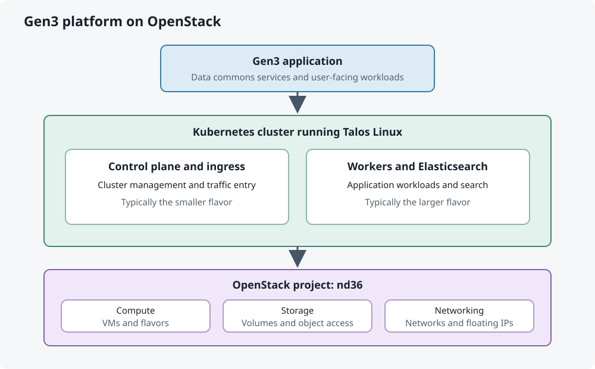
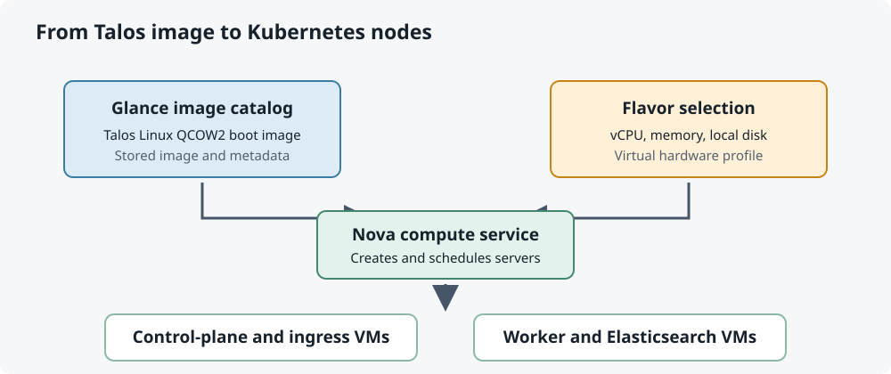
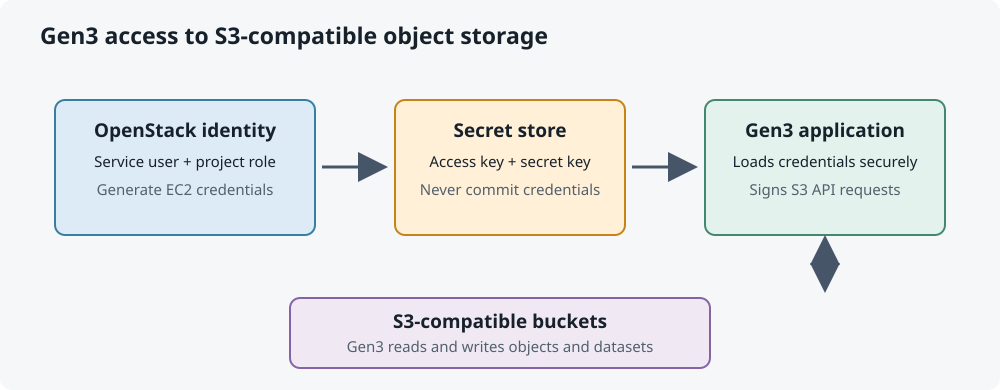

Provision an OpenStack Project for Gen3
=======================================

This page describes the Cloud Team tasks needed to prepare an OpenStack project
for a Gen3 environment. The examples use ``nd36`` as the project name. Replace
that value, the example usernames, and the Talos image details with values
approved for the environment being provisioned.

These are administrative operations. The commands below are separate commands;
do not paste multiple commands from different lines together as one command.

	Gen3 workloads run on Kubernetes nodes launched from the compute, storage,
	and networking resources available to the OpenStack project.

1. Create the project and set its quotas
----------------------------------------

Request an NCI project through `my.nci.org.au <https://my.nci.org.au>`_ first.
Once that request is approved, the Cloud Team can create the corresponding
OpenStack project, set resource limits, and add the initial member.

Switch to the provisioning account in its own command:

.. code-block:: console

	sudo su - provision

Then create the project:

.. code-block:: console

	provision project create --project nd36 --cores 128 --memory 256GB --volume 2TB --floating-ips 3 --initial-member dxp900 --description "Gen3 Training"

The project name is ``nd36``. The requested limits are 128 CPU cores, 256 GB
of memory, 2 TB of volume storage, and three floating IP addresses. The
``--initial-member`` option adds ``dxp900`` when the project is created, and
``--description`` records its purpose. These are limits, not resources
automatically allocated to running machines.

Set the block-storage quotas for the project:

.. code-block:: console

	openstack quota set --volume-type Nirin2_Transaction --gigabytes 2048 --volumes -1 --snapshots 10 nd36

This command sets block-storage limits on project ``nd36``. Each option
controls a different part of that limit:

* ``--volume-type Nirin2_Transaction`` applies the quota to volumes of this
	storage type. That type must exist and be available in the target cloud.
* ``--gigabytes 2048`` allows the project to use up to 2,048 GB of capacity
	for this volume type. For example, four 500 GB volumes would use 2,000 GB
	of the quota, leaving 48 GB. The cloud's quota display is the best reference
	for the exact unit convention.
* ``--volumes -1`` removes the separate limit on the *number* of volumes.
	It does not remove the capacity limit: creating another volume is still
	subject to the 2,048 GB quota and available cloud capacity.
* ``--snapshots 10`` allows up to 10 snapshots for the project under this
	quota. A snapshot is a point-in-time copy of a volume; it is not the same
	thing as a new volume.

These settings are ceilings, not a request to create or reserve 2,048 GB of
storage. They are also distinct from the ``--volume 2TB`` limit passed to the
project-creation command above: this command configures OpenStack's
block-storage quota for the named volume type.

Grant project membership to the other users who need access:

.. code-block:: console

	provision membership grant --project nd36 --user dmo900 --user yyy900 --user jxl900 --user jxj900

After the project and memberships are in place, members can sign in to the
OpenStack dashboard at `cloud.nci.org.au <https://cloud.nci.org.au>`_ with
their LDAP credentials. Their actual permissions depend on the roles assigned
to them.

2. Make the Gen3 flavors available
----------------------------------

An OpenStack flavor is a predefined virtual-machine hardware profile. It
specifies the resources a new virtual machine receives, typically including
the number of virtual CPUs (vCPUs), memory, and any local ephemeral disk. When
someone launches a server, they choose a flavor and OpenStack uses that
profile to request matching compute capacity from the cloud.

For example, the ``c3ep.4c8m20d`` name can indicate a profile with 4 vCPUs, 8 GB
of memory, and 20 GB of ephemeral disk while ``c3ep.8c16m80d`` may provide 8 vCPUs,
16 GB of memory, and 80 GB of ephemeral disk. 

A flavor is different from an image: the flavor describes the virtual
hardware, while the Talos image later in this guide provides the operating
system that boots on that hardware. Making a flavor available to a project
allows its users to select it when launching servers. It does not create
servers, reserve capacity, or assign a flavor to a particular node. The Cloud
Team must make the required flavors available to the project before users can
launch Gen3 nodes with them.

.. note::

    In AWS, the closest equivalent to an OpenStack flavor is an **EC2 instance
    type**, such as a general-purpose or compute-optimized instance type.

The production Gen3 environment uses these flavors:

* ``c3ep.4c8m20d``: control-plane and ingress nodes.
* ``c3ep.8c16m80d``: worker and Elasticsearch nodes. 

If the flavors are not already assigned, run each command separately:

.. code-block:: console

	openstack flavor set c3ep.4c8m20d --project nd36
	openstack flavor set c3ep.8c16m80d --project nd36

The ``--project`` option grants that project access to the flavor. It does not
create a new flavor or reserve compute capacity.

3. Ensure a Talos image is available
------------------------------------

Talos is the operating-system image used to boot the Gen3 virtual machines.
First check whether the required version is already in the cloud image catalog.

.. code-block:: console

	openstack image list | grep -i Talos

If the required version is missing, obtain the matching QCOW2 file from the
official Talos source and verify its checksum against the published value
before uploading it. The example below must be updated to match the actual
file name, release, date, and checksum:

.. code-block:: console

	openstack image create "Talos Linux 1.13.9 2026-09-02" --disk-format qcow2 --container-format bare --min-disk 5 --min-ram 0 --file talos-1.13.9-openstack.qcow2 --property hw_disk_bus=scsi --property hw_scsi_model=virtio-scsi --property os_hash_algo=sha512 --property os_hash_value=9b7e4880e8208eefe7a6ae0aeb12aa9c045706c06aca91a216635084c18e8ad0794191659bdffc281d15d403b031b2eb1f8fe781abcd24bcf8d4939d6fec794c --public

Glance is OpenStack's image service. It stores virtual-machine images and
their descriptive metadata in a catalog, so users can find and select an
image when creating a server. In this example, the Talos QCOW2 file is uploaded to Glance so it can be
selected as the operating-system image for Gen3 nodes. The flavor determines
the server's virtual hardware, while the image supplies its boot contents.

The command uploads the local image file to Glance. ``qcow2`` and ``bare``
describe the image and container formats; ``--min-disk 5`` and ``--min-ram 0``
specify minimum launch requirements. The SCSI properties tell the virtual
machine how to present its disk. The hash options are image metadata in this
command: independently checking the downloaded file against the trusted
published checksum is what verifies the file before upload. ``--public``
makes the image visible to all OpenStack projects, so only use it when that
visibility is intended and permitted.

	The image provides the operating system; Nova combines it with a selected
	flavor when it launches each virtual machine.

4. Create an S3 service account and credentials
------------------------------------------------

Gen3 needs S3-compatible credentials to access its object-storage buckets.
Create a dedicated service user rather than reusing a person's LDAP account.

	The service credentials authenticate Gen3's requests to read and write
	objects in its S3-compatible buckets.

Create the user in the NCI service-user domain:

.. code-block:: console

	openstack user create --domain NCI_service_users --description "nd36 s3 service user" nd36_s3

Grant it the service role on the ``nd36`` project:

.. code-block:: console

	openstack role add --user-domain NCI_service_users --project-domain NCI --project nd36 --user nd36_s3 _service_user_

The role assignment gives the account the project access defined by the NCI
``_service_user_`` role. A role assignment by itself does not necessarily
disable interactive authentication; follow the cloud's service-account
policy and do not configure a human login for this identity.

Generate EC2 credentials for use with S3-compatible object storage:

.. code-block:: console

	openstack ec2 credentials create --user nd36_s3 --user-domain NCI_service_users --project nd36 --project-domain NCI

The returned access and secret keys are used by Gen3's object-storage
configuration. Treat the secret key like a password: transfer it through the
approved secret-management process, store it in the designated secret store,
and do not commit it to source control or include it in logs.
 