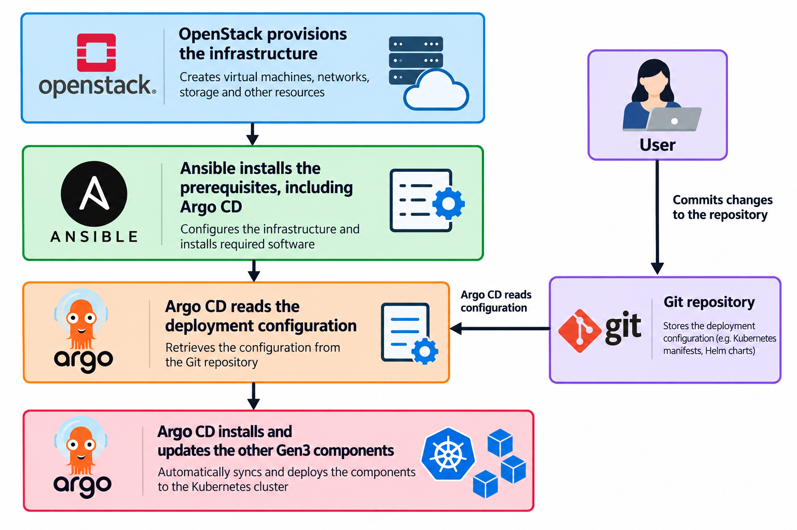

Prerequisites
=============

Several prerequisites must be completed before you can proceed to the inventory
and build phases.

Gen3 ArgoCD Git Repository
--------------------------

Gen3 uses ArgoCD for deployment. ArgoCD uses a Git repository as the source for
deploying Gen3. You will need a repository to hold the manifests and values. The
repositories for existing Gen3 Commons already exist, but they need directories
for deployment data (Eg: Data dictionary) and configuration (Eg: Portal design). If you are 
creating a new commons, you will need to create a new repository with the required files.

Ansible deploys the ArgoCD service, which then deploys Gen3. The 1000 Genomes
environment uses the repository ``git.nci.org.au:nci-cloud/gen3-argocd.git``.
Each commons generally has a top-level directory for each environment, such as
Dev, Test, and Production.

For a training environment, create a top-level directory called
``gen3-train``. Use an existing environment directory as a template so the new
directory follows the layout expected by the repository. Copy its required
manifests and values, then update them for the training environment, including
environment-specific settings such as the dictionary location and portal
configuration. ArgoCD will use these files to deploy and configure the Gen3
environment.

.. note::

    The repository, directory name, and branch will all be used in the Ansible
    inventory created in the next step.

You will also need to create an Ansible service account that ArgoCD can use to
retrieve files from Git.

Gen3 ArgoCD Values
------------------

As a starting point, you will need to understand these basic components of a
Gen3 deployment:

* The Gen3 data dictionary
* The data structure used for filtering in the portal
* The look and feel of the portal
* The ETL process and the corresponding metadata

.. note::

    The following sections explain these components in more detail using a
    generic example. Adapt the example to your environment and requirements.
    For more information, refer to the Gen3 documentation on configuring these
    components.

The Gen3 Git repository used by ArgoCD contains the configuration that describes
how a commons should be deployed. ArgoCD reads these files and applies the
desired configuration to the running environment. In this way, Git is the
record of the configuration: when approved changes are committed, ArgoCD can
bring the deployed environment into line with them.

Each top-level environment directory groups the files for one deployment. Use
an existing directory as a working example: it shows the expected file layout
and how the settings fit together. 

.. note::
    
    The example directory is a starting point, not a complete setup. Review and
    update environment-specific values, such as URLs, identity-provider
    settings, and storage locations, before deploying. 

The data dictionary describes the kinds of data in the commons and how they
relate. It defines the metadata fields that Gen3 services use to validate,
index, and present records. Place the dictionary file in the S3 bucket created
when the OpenStack project was provisioned. Gen3 is configured with a
presigned URL, which grants time-limited access to the file without making the
bucket public. After uploading the dictionary, create the URL using the S3
service account created during OpenStack provisioning. Configure the URL in
the ``values.yaml`` file under ``environment/gen3/values``. Ensure that the URL
remains valid for the way the deployment accesses the dictionary.

For example, copy an existing top-level directory such as ``gen31k-test`` to a
new directory such as ``gen31k-train``. Then review and adapt its configuration
for your commons. The main items to understand are:

* **Data structure:** The dictionary's nodes and properties describe the
    records and fields in your data. The portal uses this structure to present
    data and provide filters.
* **ETL configuration:** ETL means extract, transform, and load. These settings
    tell the ETL process how to read source data, map it to the dictionary, and
    load the resulting records into Gen3.
* **Portal CSS:** CSS controls the visual styling of the data portal, such as
    colors, fonts, and layout.
* **Portal GitOps configuration:** This configuration tells ArgoCD which portal
    settings or resources to deploy and where to obtain them.
* **OIDC configuration:** OpenID Connect (OIDC) connects Gen3 to an identity
    provider so users can sign in. The settings must match the identity provider
    configured for your environment.
* **Policies and roles:** These determine which users can access particular
    data. Policies can refer to fields and values defined in the dictionary, so
    access rules can be applied to the appropriate records.

Once you have completed these changes and committed them to the branch you are
using, you can proceed to building an inventory and running the deployment.

Gen3 Arborist/User Policies Configuration
-----------------------------------------

For an initial Gen3 environment that is not yet integrated with an AuthZ source,
such as REMS, use a suitable YAML file in the user YAML bucket created during
provisioning. Documentation for this file is available in the
`Fence user.yaml guide <https://github.com/uc-cdis/fence/blob/master/docs/additional_documentation/user.yaml_guide.md>`_.

