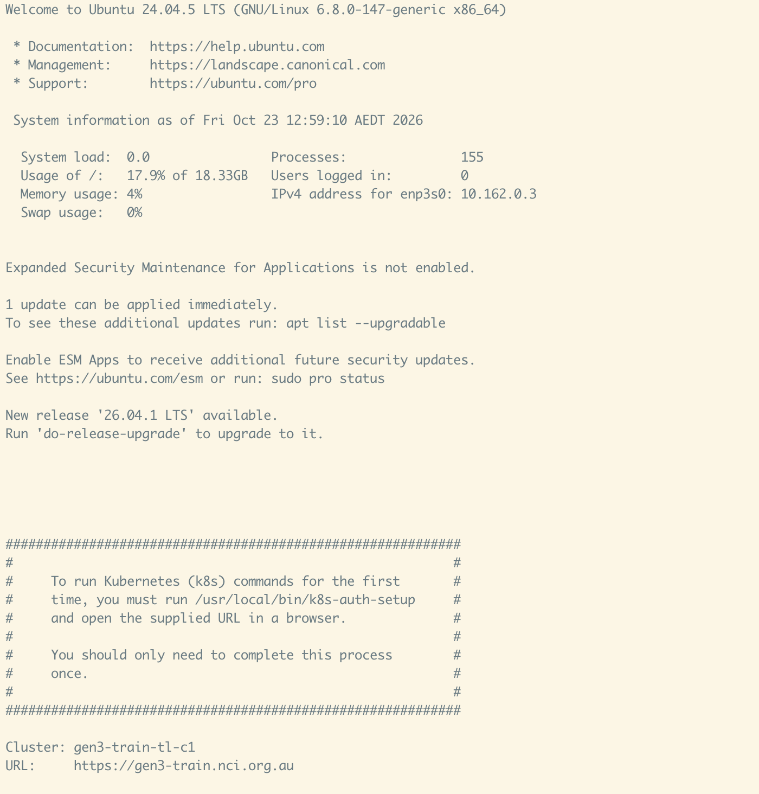
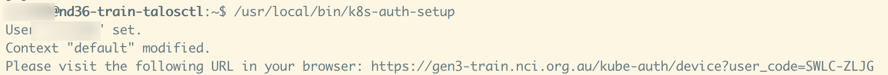
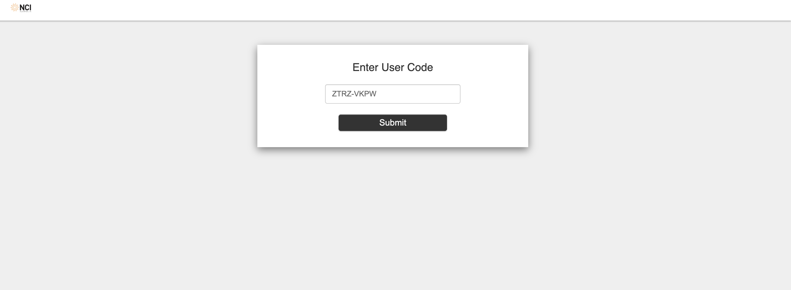
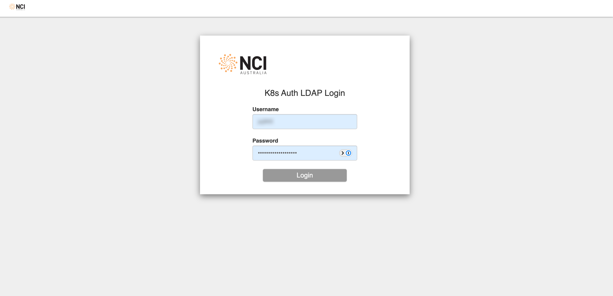
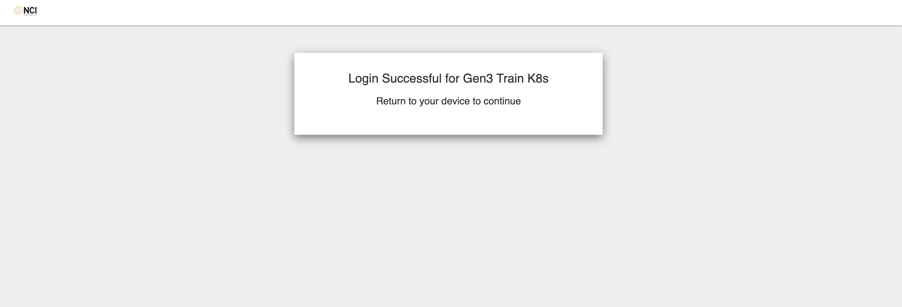

Log in to the Gen3 Training Kubernetes Cluster
===============================================

This guide describes how to authenticate to the Gen3 training Kubernetes
cluster for the first time. You will connect to the access server over SSH,
start the Kubernetes authentication setup, and complete a one-time browser
sign-in using your training account.

Connect to the access server
----------------------------

From a terminal, connect to the server provided by your course administrator.
Replace ``<username>`` and ``<server-ip>`` with your own login details:

.. code-block:: console

	ssh <username>@<server-ip>

Enter your SSH password when prompted. After connecting, the server displays
its welcome message and cluster information.

Start Kubernetes authentication
-------------------------------

On your first use of Kubernetes commands, run the authentication setup script
on the access server:

.. code-block:: console

	/usr/local/bin/k8s-auth-setup

The script configures your Kubernetes user and updates the default context. It
then prints the cluster name and URL, along with a sign-in URL containing a
temporary device code.

Complete browser sign-in
------------------------

Open the sign-in URL printed by the setup script in a browser. Use the URL and
device code from your current terminal session; the values shown in the
screenshots are examples and should not be reused.

If prompted, enter the user code from the URL or terminal output and submit it.

At the LDAP login page, sign in with your training account credentials. Do not
share your password or the temporary device code.

When the browser confirms that login was successful, return to the terminal.
The authentication process should finish there, leaving your Kubernetes
context ready for the training exercises. The setup message indicates that
this browser sign-in is normally needed only once.

